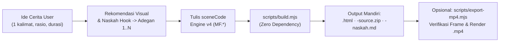

<div align="center">


# MotionCraft Skill

**Universal AI Agent Skill untuk membuat Video Explainer (`16:9`) & Shorts (`9:16`) setara studio animasi.**<br>
Ubah 1 kalimat ide cerita menjadi rekomendasi visual, naskah (`Hook → Adegan 1..N` hingga 10 menit), 1 file `index.html` mandiri, paket source code `.zip`, dan video `.mp4` dalam **16 kategori visual**.

[](CHANGELOG.md)
[](LICENSE)
[](#instalasi-lintas-platform)
[](#kebutuhan-sistem)
[](#instalasi-lintas-platform)

[Fitur Utama](#fitur-utama) · [16 Kategori Visual](#16-kategori-visual) · [Alur Kerja](#alur-kerja) · [Instalasi Lintas Platform](#instalasi-lintas-platform) · [Contoh Prompt](#contoh-prompt) · [Struktur Repo](#struktur-repositori)

</div>

---

## Mengapa MotionCraft?

Repositori ini **100% mandiri (*standalone skill*)** — tidak bergantung pada aplikasi web atau server eksternal apa pun. Seluruh mesin animasi (`assets/motion-engine.js`), synthesizer efek suara WebAudio/WAV (`assets/sfx-synth.mjs`), dan data garis pantai dunia Natural Earth (`assets/land-110m.json`) sudah tertanam langsung di dalam skill ini.

Saat kamu mengetik satu ide cerita ke agen AI favoritmu (**Claude Code, Google Antigravity, OpenAI Codex, Gemini CLI, Cursor, Windsurf**), agen akan:
1. Merekomendasikan **gaya visual, objek/prop, gerak kamera, dan suasana**,
2. Menyusun **naskah bertahap** (`HOOK` → `ADEGAN 1` → `ADEGAN 2` → dst., dari **15 detik** hingga **10 menit / 600 detik**),
3. Merakit **1 file `.html` mandiri** (tinggal klik 2x langsung berputar di browser, lengkap tombol ganti rasio langsung `9:16` Shorts ↔ `16:9` Video), **paket `.zip` source code**, dokumen **naskah `.md`**, hingga **render `.mp4`**.

---

## Fitur Utama

| Kemampuan | Detail |
| :--- | :--- |
| 🎨 **16 Kategori Gaya Studio** | Mencakup 3D prosedural Three.js, kamera isometrik ortografis, stickman cel-shaded 3D, shader GLSL lubang hitam, peta dunia nyata `d3-geo`, biota laut 3D, anatomi EKG, hingga kaligrafi cahaya Islami & cerita rakyat. |
| 📱🖥️ **Responsif Ganda (`9:16` & `16:9`)** | Setiap proyek mendukung format vertikal Shorts/Reels/TikTok (`1080×1920`) maupun widescreen YouTube (`1920×1080`) dan dapat diganti langsung lewat tombol di pemutar HTML. |
| 📜 **Naskah & Durasi s.d. 10 Menit** | Dilengkapi arsitektur modular multi-bab untuk video pendek (`15–60 dtk`) maupun dokumenter/explainer panjang (`1–10 menit`). |
| 📦 **Zero-Dependency Builder** | `scripts/build.mjs` hanya memakai modul bawaan Node.js (`node:fs`, `node:zlib`) — **tanpa `npm install`**! |
| 🔊 **Audio SFX Prosedural** | Efek suara (`pop`, `whoosh`, `scribble`, `stamp`, `ding`, `boing`, `click`, `riser`) disintesis otomatis di browser maupun ke track WAV saat ekspor MP4. |

---

## 16 Kategori Visual

| # | Kategori | ID Gaya (`style`) | Mesin & Ciri Khas Visual |
| :--- | :--- | :--- | :--- |
| 1 | **3D** | `monumen-3d` | Rekonstruksi menara, candi, piramida, & kapal prosedural Three.js + langit senja & kabut `FogExp2` |
| 2 | **Isometrik** | `isometrik-mesin` | Kamera ortografis 3D membongkar lapisan mesin, baterai, turbin, & aliran energi |
| 3 | **Bongkar Rumah** | `isometrik-cutaway` | Rumah beratap/berdinding terangkat (`peelAway`) menyingkap pipa, MCB listrik, & struktur dalam |
| 4 | **Stickman 3D** | `stickman-3d` | Karakter stickman cel-shaded 3D ekspresif di atas meja kayu bersama benda logam/fisik 3D raksasa |
| 5 | **Astronomi** | `sinematik-3d` | Shader GLSL raymarching lubang hitam (*gravitational lensing* & Doppler) + planet atmosfer Fresnel |
| 6 | **Dunia Hewan** | `dunia-hewan` | Satwa berlapis di lanskap savana/hutan atmosferik + visualisasi gelombang indera (infrasonik/sonar) |
| 7 | **Laut** | `biota-laut-3d`, `neon-mikro` | Paus biru & kawanan ikan 3D bertekstur kulit totol + sinar bawah air volumetrik / bioluminesensi abisal |
| 8 | **Sains & Alam** | `kertas-cutout`, `komik-manga`, `tanah-liat-3d` | Diorama kertas berlapis, panel komik fisika cepat, & plastisin claymation 3D 12fps |
| 9 | **Sejarah** | `kolase-jurnalisme`, `ukiran-sketsa`, `retro-crt` | Meja arsip investigasi benang merah, buku sketsa etsa sepia klasik, & monitor fosfor CRT 8-bit |
| 10 | **Peta** | `peta-perkamen` | Garis pantai Bumi asli (`world-atlas` + `d3-geo`) di buku perkamen tua + kapal layar & rute pelayaran |
| 11 | **Islami** | `kisah-islami`, `manuskrip-emas` | Cahaya mihrab khusyuk & bingkai geometris emas ilmuwan Muslim (*santun tanpa menggambar sosok Nabi*) |
| 12 | **Geografi** | `geografi-skala`, `peta-atlas` | Perbandingan skala negara nyata di atas atlas modern & transisi `whipTo` penampang geologi |
| 13 | **Anatomi** | `anatomi-tubuh` | Studio medis merah-lembayung, sel darah mikro, monitor EKG hidup, & organ berdenyut (*lub-dub*) |
| 14 | **Cerita Rakyat** | `diorama-rakyat`, `cat-air` | Lanskap dramatis legenda Nusantara (rumah adat, perahu, gunung) & sapuan pigmen cat air organik |
| 15 | **Kartun** | `kartun-panggung` | Panggung edukasi cerah dengan karakter manusia bersendi penuh dikelilingi properti ruangan hidup |
| 16 | **Animasi 2D** | `kartun-2d`, `katalog-risograf`, `infografis-kaca`, `tipografi-kinetik` | Dunia paralaks vektor mengalir, kartu cetak risograf, grafik kaca *frosted*, & tipografi kinetik |

---

## Alur Kerja



---

## Instalasi Lintas Platform

MotionCraft mengikuti standar terbuka **Agent Skills** (`SKILL.md` + `references/` + `examples/` + `assets/` + `scripts/`) serta menyertakan manifest plugin resmi **Claude Code** dan instruksi **Codex (`AGENTS.md`)**.

### 1. Claude Code (Otomatis via Plugin Marketplace)
Jalankan langsung di dalam **Claude Code**:
```text
/plugin marketplace add alpianreza/motion-craft
/plugin install motion-craft@motion-craft
```
Atau pasang manual dengan meng-clone ke folder skill Claude:
```bash
# macOS / Linux:
git clone https://github.com/alpianreza/motion-craft.git ~/.claude/skills/motion-craft

# Windows (PowerShell):
git clone https://github.com/alpianreza/motion-craft.git "$HOME\.claude\skills\motion-craft"
```

### 2. Google Antigravity (`agy` / Antigravity IDE)
Pasang secara global agar aktif di semua workspace Antigravity:
```bash
# macOS / Linux:
git clone https://github.com/alpianreza/motion-craft.git ~/.gemini/config/skills/motion-craft

# Windows (PowerShell):
git clone https://github.com/alpianreza/motion-craft.git "$HOME\.gemini\config\skills\motion-craft"
```
*(Atau pasang per-proyek di `.agents/skills/motion-craft`).*

### 3. OpenAI Codex CLI
Clone ke direktori skill Codex:
```bash
# macOS / Linux:
git clone https://github.com/alpianreza/motion-craft.git ~/.codex/skills/motion-craft

# Windows (PowerShell):
git clone https://github.com/alpianreza/motion-craft.git "$HOME\.codex\skills\motion-craft"
```

### 4. Gemini CLI · Cursor · Windsurf · Cline · Roo Code
| Agen AI | Lokasi Instalasi / Cara Pakai |
| :--- | :--- |
| **Gemini CLI** | Clone ke `~/.gemini/skills/motion-craft` atau referensikan `motion-craft/SKILL.md` di `GEMINI.md` |
| **Cursor** | Clone ke `.cursor/skills/motion-craft` atau tambahkan aturan di `.cursor/rules` agar membaca `SKILL.md` |
| **Windsurf / Cline / Roo** | Clone ke `.agents/skills/motion-craft` dan arahkan `.windsurfrules` / `.clinerules` ke `SKILL.md` |
| **Claude.ai / ChatGPT Web** | Unggah `SKILL.md`, `references/categories-16.md`, `references/engine-v4-api.md`, `examples/golden-showcases.md`, `assets/starter-template.html`, & `assets/motion-engine.js` ke Project Knowledge |

> **Catatan:** Pasang hanya **satu salinan** pada tiap agen agar tidak terjadi duplikasi nama skill.

---

## Contoh Prompt

```text
Buatkan Shorts 9:16 durasi 35 detik tentang kenapa pinggiran koin dibuat bergerigi, pilihkan gaya visual yang paling cocok lengkap naskah Hook sampai penutup!
```
```text
Bikin video explainer 16:9 durasi 3 menit tentang jalur perdagangan rempah Nusantara ke Eropa memakai peta garis pantai asli dan kapal layar!
```
```text
Jelaskan cara kerja baterai solid-state dalam gaya Isometrik 3D dibongkar per lapisan, durasi 45 detik, keluarkan file HTML, source ZIP, dan MP4.
```
```text
Buat animasi Shorts kategori Laut tentang bagaimana paus biru berkomunikasi melintasi samudra, durasi 40 detik.
```

---

## Kebutuhan Sistem

| Kebutuhan | Yang Diperlukan |
| :--- | :--- |
| **Menonton hasil (`.html`)** | Cukup browser modern + koneksi internet (GSAP, Three.js, d3-geo, & Google Fonts dimuat dari CDN publik). |
| **Merakit paket (`.html`, `.zip`, `.md`)** | **Node.js ≥ 20** saja (`scripts/build.mjs` murni memakai modul bawaan Node, **0 `npm install`**). |
| **Verifikasi headless & Export `.mp4`** | Opsional: Chrome/Edge + `puppeteer-core` (`npm i -g puppeteer-core`) + `ffmpeg` di `PATH`. |

---

## Struktur Repositori

```text
motion-craft/
├── SKILL.md                     # Instruksi utama Agent Skills (dibaca otomatis oleh semua agen)
├── AGENTS.md                    # Penunjuk cepat untuk OpenAI Codex & repo-level agents
├── .claude-plugin/              # Manifest plugin & marketplace resmi Claude Code
│   ├── plugin.json
│   └── marketplace.json
├── assets/                      # Mesin runtime mandiri (tanpa ketergantungan aplikasi luar!)
│   ├── motion-engine.js         # MotionCraft Engine v4 (Three.js, GLSL, SVG rig, d3-geo, kamera)
│   ├── sfx-synth.mjs            # Synthesizer efek suara WebAudio & offline WAV
│   ├── land-110m.json           # TopoJSON garis pantai dunia Natural Earth
│   └── starter-template.html    # Template pemutar mandiri (9:16 <-> 16:9 live toggle + scrub bar)
├── references/
│   ├── categories-16.md         # Katalog 16 kategori & resep pemilihan gaya visual
│   ├── engine-v4-api.md         # Dokumentasi lengkap fungsi MF.*
│   └── longform-10min.md        # Arsitektur modular video 1 s.d. 10 menit (600 detik)
├── examples/
│   └── golden-showcases.md      # 8 contoh kode referensi berstandar studio
└── scripts/
    ├── build.mjs                # Pembangun .html, -source.zip, & -naskah.md (0 npm dependency!)
    └── export-mp4.mjs           # Verifikasi frame headless (--verify-only) & render video MP4
```

---

## Lisensi

Dirilis di bawah lisensi [MIT](LICENSE).
